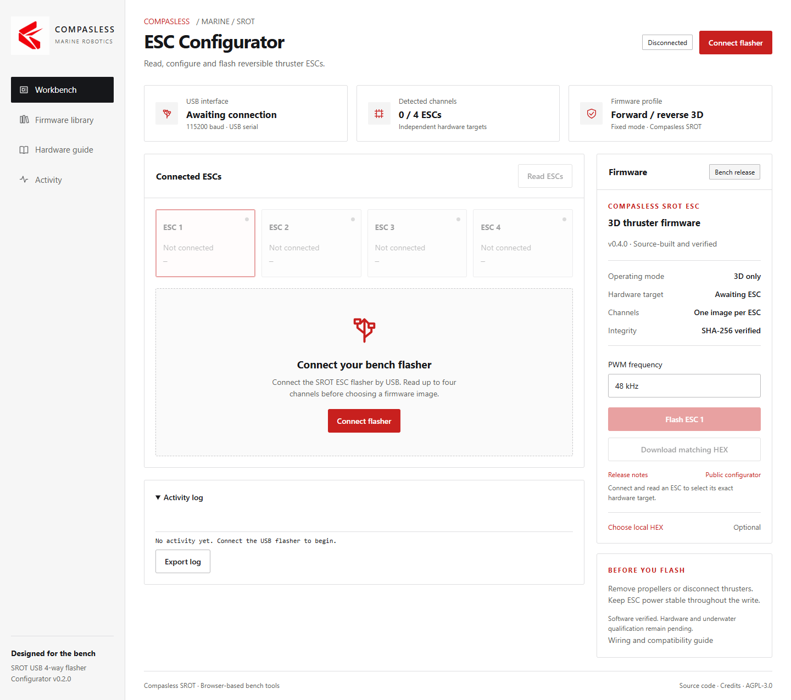

# SROT ESC Configurator

**COMPASLESS / MARINE ROBOTICS**

Browser-based flashing and configuration for Compasless SROT 3D thruster ESCs.

[Open configurator](https://compasless.github.io/srot-esc-configurator/) · [Firmware releases](https://github.com/Compasless/srot-esc-firmware/releases/tag/v0.4.0) · [Flasher hardware](https://github.com/Compasless/srot-esc-flasher)

## Use

Open the configurator in desktop Chrome or Edge, connect the SROT USB flasher,
read the ESC channels, select a channel and flash its matching firmware.

- Up to four independent ESC channels over MSP/4-way at 115200 baud.
- All 1,008 verified v0.4.0 hardware targets included.
- SHA-256 validation, layout/MCU checks and write/readback verification.
- Parameter editing with the motor operating mode fixed at 3D.
- Settings/log export and matching HEX downloads for public ESC Configurator.

Remove propellers or disconnect thrusters before bench flashing. No physical ESC
or underwater qualification is claimed. The inherited 3D performance issue remains
unresolved. See the [firmware compatibility notes](https://github.com/Compasless/srot-esc-firmware/blob/main/docs/COMPATIBILITY.md).

## Develop

Requires Node 22 or later:

    npm ci
    npm run build
    npm test
    npm run qa
    npm run preview

Open http://127.0.0.1:4173. Browser QA uses installed Chrome/Edge, or Playwright
Chromium installed with `npx playwright install chromium`. Tests use simulated
hardware and never request real serial devices.

GitHub Actions builds and tests every update; successful main builds deploy to
GitHub Pages. The lock file pins the original ESC Configurator source archive
and the published firmware ZIP. Firmware bytes are never changed by this project.

## Brand and license

The interface follows the supplied Compasless guideline: signal red #C8201E,
white #FFFFFF and black #16171A. See [brand implementation](docs/BRAND.md).

Based on ESC Configurator 0.32.1. Serial/MSP/4-way and flash verification code retain
their original notices. This application is AGPL-3.0; see LICENSE and NOTICE.
Firmware and company artwork retain their respective licenses and ownership.
